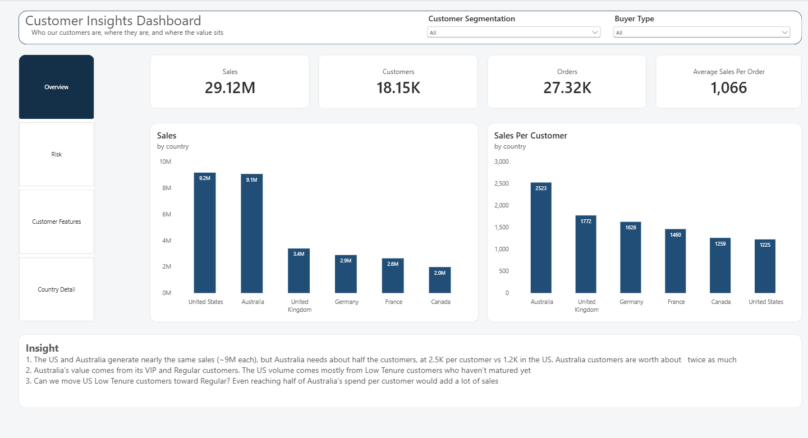
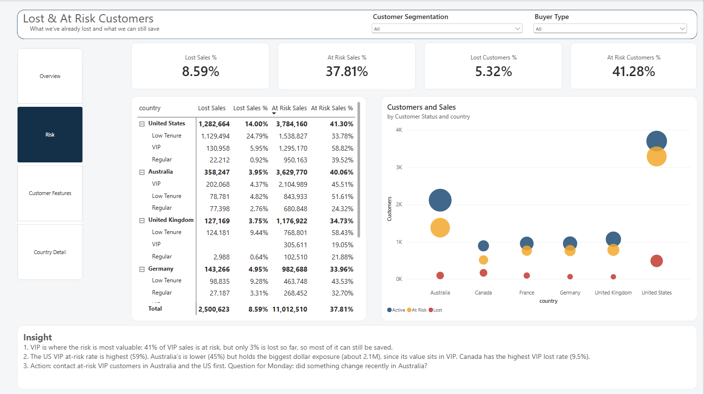
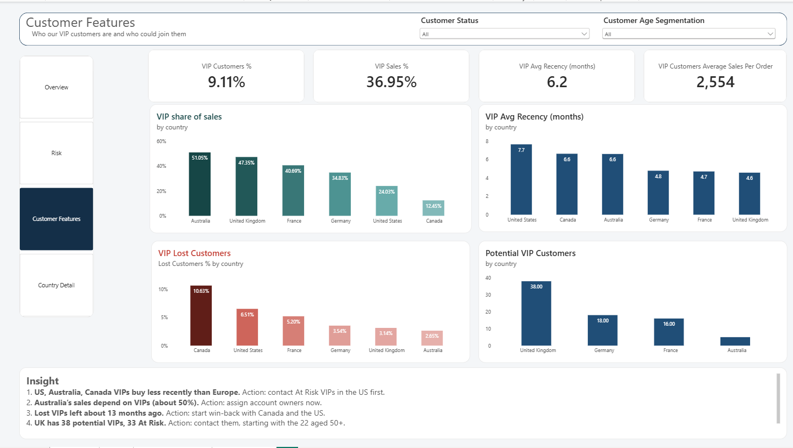
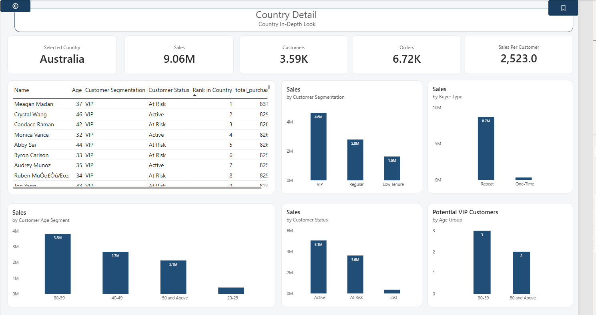

# SQL Business Analysis and BI

## Overview

This project focuses on business analysis and reporting using **Microsoft SQL Server** and **Power BI**.

It builds on the Gold layer developed in the SQL Data Warehouse project and uses its dimensional model to explore business performance, analyze customer behavior, and develop reusable reporting views.

The project includes:
- Exploratory Data Analysis (EDA) using SQL.
- Analytical SQL queries to identify trends and business insights.
- Customer and product reporting views.
- An interactive Power BI Customer Insights Dashboard.

**Source Data Warehouse:** [SQL Data Warehouse Project](https://github.com/attaeezadehmahdi/sql-data-warehouse-project)

## Project Objectives

- Explore and understand the available business data.
- Analyze sales trends and business performance.
- Evaluate customer and product purchasing behavior.
- Identify customer segments, risks, and opportunities.
- Develop reusable SQL reporting views.
- Build an interactive Power BI dashboard to support business analysis.

## Data Source

The analysis uses the Gold layer of the SQL Data Warehouse project, consisting of:

| Table | Description |
|---|---|
| `gold.dim_customers` | Customer information and demographic attributes |
| `gold.dim_products` | Product information and categories |
| `gold.fact_sales` | Sales transaction records |

The raw datasets and ETL process are maintained in the source data warehouse repository. Refer to [`data/README.md`](data/README.md) for information about the data dependency and setup.

## Repository Structure

```text
sql-business-analysis-and-bi/
│
├── data/
│   └── README.md
│
├── sql/
│   ├── eda/
│   │   ├── 01_database_exploration.sql
│   │   ├── 02_date_exploration.sql
│   │   ├── 03_measures_exploration.sql
│   │   ├── 04_magnitude_analysis.sql
│   │   └── 05_ranking_analysis.sql
│   │
│   ├── analysis/
│   │   ├── 01_change_over_time_analysis.sql
│   │   ├── 02_cumulative_analysis.sql
│   │   ├── 03_performance_analysis.sql
│   │   └── 04_part_to_whole_analysis.sql
│   │
│   └── reports/
│       ├── customer_report.sql
│       └── product_report.sql
│
├── powerbi/
│   └── customer_dashboard.pbix
│
├── reports/
│   └── screenshots/
│       ├── 01_customer_overview.png
│       ├── 02_customer_risks.png
│       ├── 03_customer_features.png
│       └── 04_country_detail.png
│
└── README.md
```

## SQL Analysis

### 1. Exploratory Data Analysis (EDA)

The EDA scripts explore the database structure, data characteristics, and key business measures.

| Analysis | Purpose |
|---|---|
| Database Exploration | Examine available tables and columns |
| Date Exploration | Understand date ranges and identify available time periods |
| Measures Exploration | Calculate key business measures and metrics |
| Magnitude Analysis | Compare measures across business dimensions |
| Ranking Analysis | Identify top- and bottom-performing products and customers |

### 2. Analytical SQL Analysis

These scripts use SQL techniques to analyze business performance and identify patterns.

| Analysis | Purpose |
|---|---|
| Change-over-Time Analysis | Explore monthly and yearly trends |
| Cumulative Analysis | Calculate running totals and moving averages |
| Performance Analysis | Evaluate performance against historical averages and previous periods |
| Part-to-Whole Analysis | Analyze category contributions to overall sales |

### 3. Reporting Views

Reusable SQL views provide customer- and product-level metrics for reporting and further analysis.

**Customer Report — `gold.customer_report`**

Provides a customer-level overview, including:

- Customer demographics and geographic information.
- Total purchases, quantity, and order count.
- Customer lifespan and purchase recency.
- Customer segmentation: VIP, Regular, and Low Tenure.
- Customer status: Active, At Risk, and Lost.
- Customer age groups.
- Average order value and monthly purchase.
- Customer ranking within each country.

**Product Report — `gold.product_report`**

Provides product-level purchasing metrics and performance classifications for further analysis and reporting.

## Power BI Dashboard

The project includes an interactive **Customer Insights Dashboard** designed to analyze customer performance, identify risks, and support customer-focused business decisions.

### Dashboard Pages

#### 1. Customer Overview

Provides a high-level view of customer and sales performance, including key KPIs and country-level comparisons.



#### 2. Lost & At Risk Customers

Examines lost and at-risk customers, highlighting their contribution to sales and identifying customer segments and countries requiring attention.



#### 3. Customer Features

Analyzes VIP customers, their contribution to sales, purchasing recency, and potential opportunities to develop high-value customers.



#### 4. Country Detail

Provides a detailed country-level view through drill-through functionality, allowing customer performance and purchasing behavior to be examined within a selected country.



## Tools and Technologies

- **Microsoft SQL Server** — Data exploration, analysis, and reporting views.
- **T-SQL** — SQL querying and analytical transformations.
- **Power BI** — Data visualization and interactive dashboard development.

## Related Project

[SQL Data Warehouse Project](https://github.com/attaeezadehmahdi/sql-data-warehouse-project) — The upstream project that develops the Gold layer used in this analysis.
